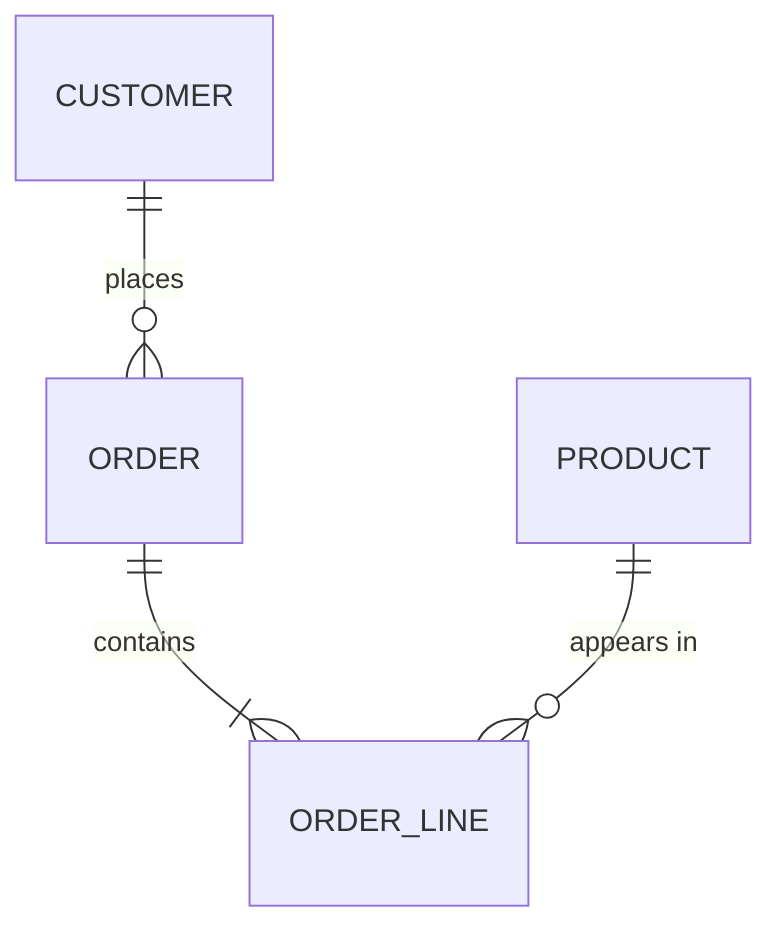
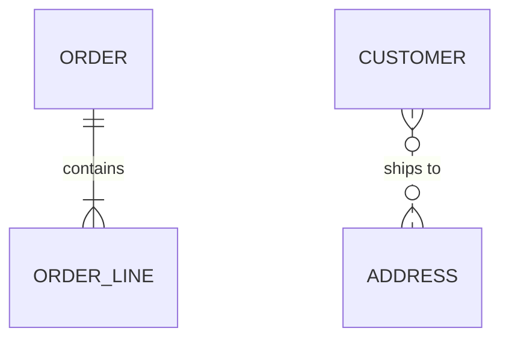
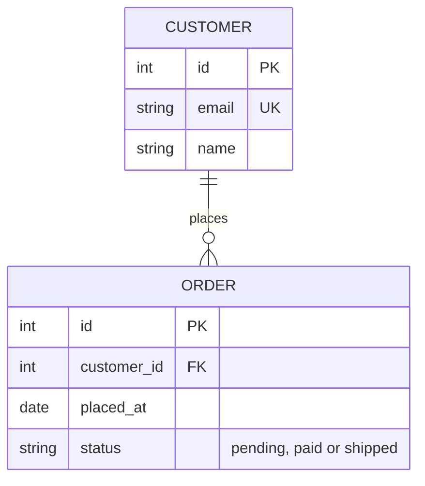
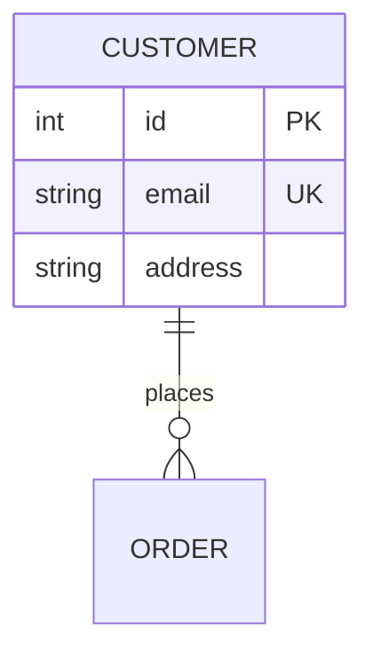
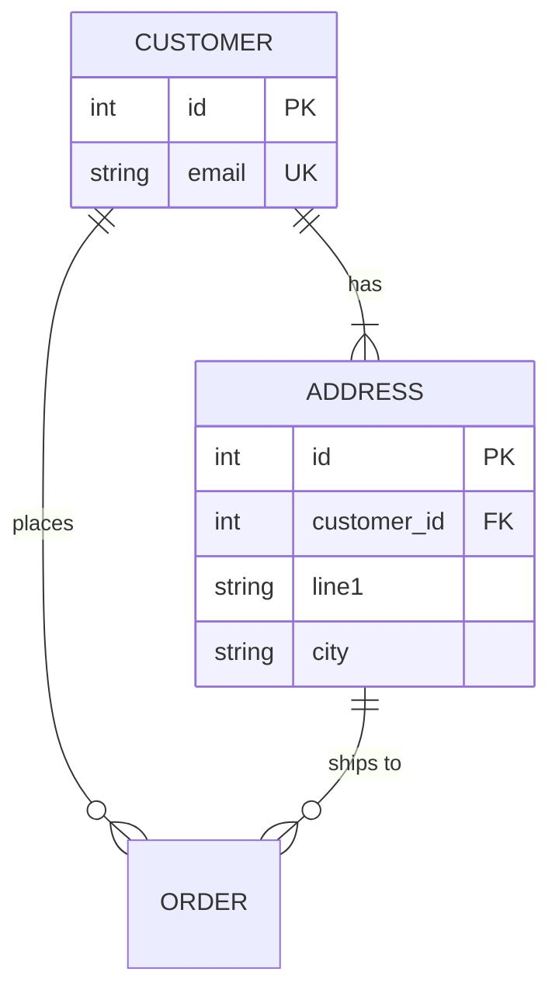
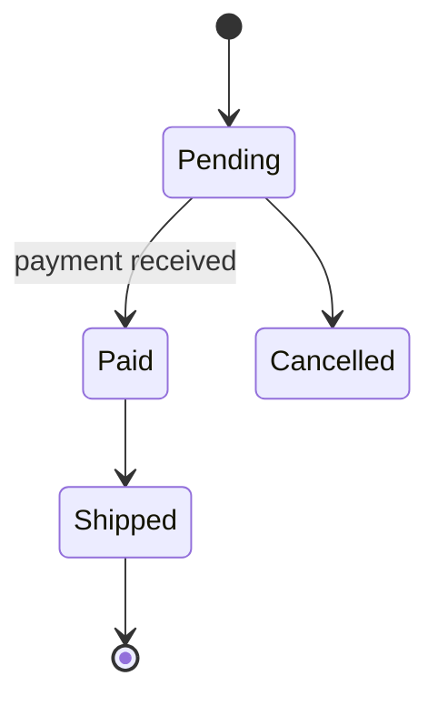

::: v-pre

# Mermaid entity relationship diagrams, explained by example

By <a href="https://halit.org">Halit Sever</a> · <time datetime="2026-11-28">28 November 2026</time>

An entity relationship diagram shows the things your system stores and how they connect. Mermaid draws one from a few lines of text using crow's foot notation. This guide covers the syntax from the Mermaid docs and shows how to explain a schema change with a before and after pair.

## The basics

Each line is one relationship: first entity, the relationship symbol, second entity, a colon and a label. The label is required. Quote it when it has spaces. Entities are created the first time they are named.

## Cardinality

The symbol has three parts: the left end, the line, the right end. The [Mermaid ER docs](https://mermaid.js.org/syntax/entityRelationshipDiagram.html) list four end markers:

| Left | Right | Meaning |
| --- | --- | --- |
| `\|o` | `o\|` | zero or one |
| `\|\|` | `\|\|` | exactly one |
| `}o` | `o{` | zero or more |
| `}\|` | `\|{` | one or more |

So `CUSTOMER ||--o{ ORDER` reads: one customer places zero or more orders, and each order belongs to exactly one customer. Read each end from the side of the entity it touches.

## Identifying or not

| Line | Drawn as | Meaning |
| --- | --- | --- |
| `--` | solid | identifying: the child cannot exist without the parent |
| `..` | dashed | non-identifying: they are related but independent |

## Attributes and keys

One attribute per line: type, name, then optional keys (`PK`, `FK`, `UK`, comma-separated for more than one) and an optional comment in quotes.

## Explaining a schema change

The explain-to-customer skill's diagram guide reserves `erDiagram` for `audience=technical` runs, because a data model is rarely what a non-technical client needs. For a technical client, or a teammate reviewing a migration, a before and after pair works well.

Before: one address per customer.

After: customers keep several addresses and each order records the one it ships to.

For a non-technical client, the same change is better told as a flow: "customers can now save several addresses and pick one at checkout", drawn as a flowchart or sequence diagram rather than tables. The [sequence diagram guide](/blog/mermaid-sequence-diagram) shows that kind.

## State and flow diagrams

Two related diagram types come up in the same conversations:

**State diagrams** show the lifecycle of one record, such as an order's status. The [state diagram docs](https://mermaid.js.org/syntax/stateDiagram.html) use `stateDiagram-v2`:

This is often the right diagram for a client when the change is "orders now have a Cancelled state".

**Flowcharts** show a path with decisions, and start with `flowchart LR` or `flowchart TD`. The skill's own example is a sign-up form: a decision for "All fields valid?", a red field on the No branch and a hint that explains the fix.

## Tips

- Use singular, uppercase names (`ORDER`, not `orders`). Mermaid does not require it, but it reads as entities, not tables.
- Keep one diagram to the entities a change touches. A full schema dump is a different document.
- Render to SVG for docs and to PNG at scale 2 for slides, as described in [Mermaid to PNG](/blog/mermaid-to-png).

## FAQ

### What do the symbols in a Mermaid ER diagram mean?

Each end of a relationship has a marker: || exactly one, |o zero or one, }| one or more, }o zero or more. They are written next to the entity they describe, for example CUSTOMER ||--o{ ORDER.

### What is the difference between -- and .. in a Mermaid ER diagram?

Two dashes draw a solid line for an identifying relationship. Two dots draw a dashed line for a non-identifying one.

### How do I add columns to an entity?

Add a block after the entity name with one attribute per line, type first: CUSTOMER { string email UK }. Keys are PK, FK and UK.

## Related posts

- [Writing a Mermaid sequence diagram, from arrows to loops](/blog/mermaid-sequence-diagram)
- [Turning a Mermaid diagram into a PNG or SVG file](/blog/mermaid-to-png)
- [Getting a Mermaid diagram into Confluence or Google Docs](/blog/mermaid-diagram-confluence-google-docs)
- [All posts](/blog/)

:::
