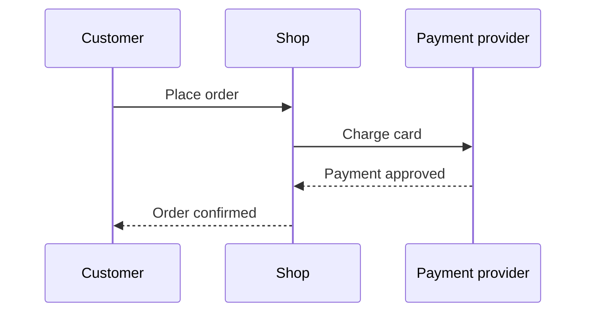
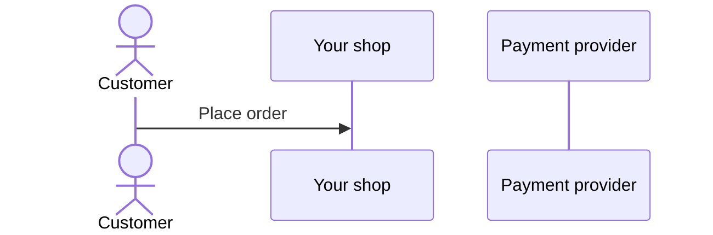
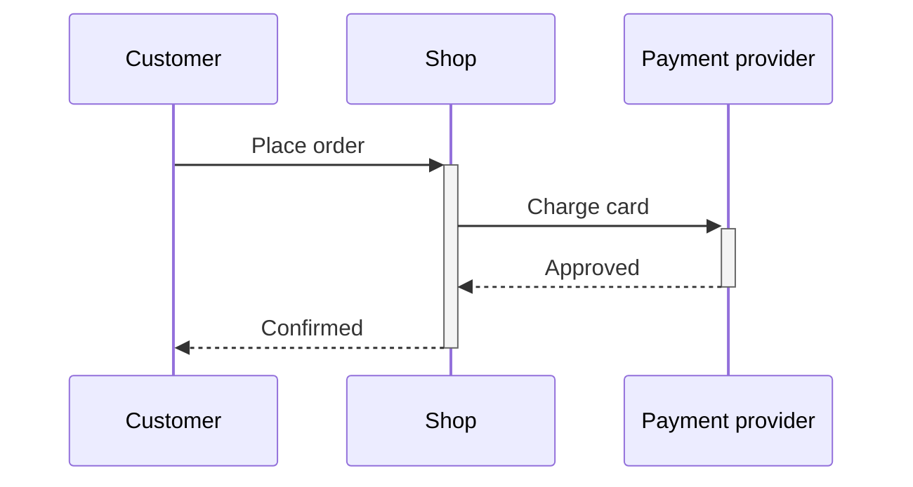
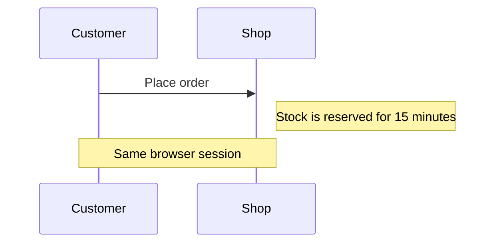
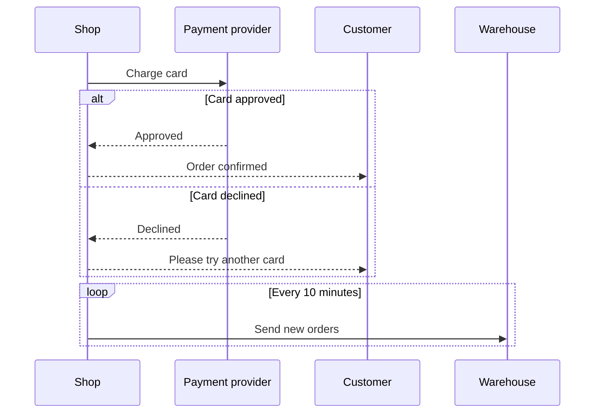
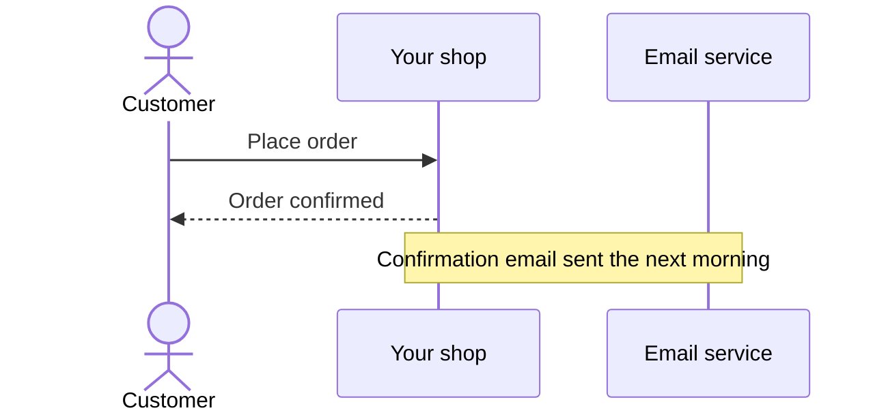
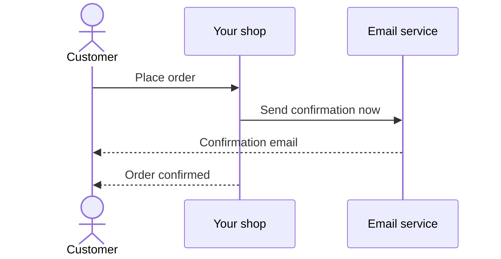

::: v-pre

# Writing a Mermaid sequence diagram, from arrows to loops

By <a href="https://halit.org">Halit Sever</a> · <time datetime="2026-11-28">28 November 2026</time>

A sequence diagram shows who talks to whom, in what order. In Mermaid you write it as text, one message per line, and the renderer draws the lifelines and arrows. This is a working reference of the syntax, checked against the Mermaid docs, with examples of the kind the explain-to-customer skill draws to show a client what happens behind a button.

## The smallest diagram

`sequenceDiagram` on the first line, then one message per line: sender, arrow, receiver, colon, label. Participants appear left to right in the order they are first mentioned. Paste it into the [Mermaid live editor](https://mermaid.live/) or a GitHub Markdown file inside a mermaid code block, and it renders.

## Participants and actors

Declare participants up front to control their order and give them short IDs:

`actor` draws a stick figure instead of a box. `as` sets the label, so IDs stay short in the message lines. Newer Mermaid versions also accept typed participants (database, queue and others) with a JSON-style config; check the [sequence diagram docs](https://mermaid.js.org/syntax/sequenceDiagram.html) for your version.

## Arrow types

| Syntax | Line | Typical meaning |
| --- | --- | --- |
| `->` | solid, no arrowhead | a link |
| `-->` | dotted, no arrowhead | |
| `->>` | solid, arrowhead | a request or call |
| `-->>` | dotted, arrowhead | a reply |
| `-x` / `--x` | solid / dotted, cross at the end | a failed or dropped message |
| `-)` / `--)` | solid / dotted, open arrow | an asynchronous message |

Keep one convention per diagram, usually `->>` for requests and `-->>` for replies, and a reader never has to ask what a line style means.

## Activations

Show when a participant is busy with `activate` and `deactivate`, or with the `+` and `-` shorthand on the arrow:

## Notes

`right of`, `left of` and `over` place the note. `over A,B` spans two participants.

## Loops, alternatives and parallel steps

| Block | Use |
| --- | --- |
| `loop label ... end` | repetition |
| `alt label ... else label ... end` | branches |
| `opt label ... end` | an optional step |
| `par label ... and label ... end` | things that happen at the same time |
| `critical label ... option label ... end` | an action with required fallbacks |
| `break label ... end` | the flow stops here, for example on an error |
| `rect rgb(...) ... end` | a coloured background around a group |

## Numbering

Put `autonumber` on the line after `sequenceDiagram` and every arrow gets a number. Useful when you talk a client through the steps on a call: "at step 3 the card is checked".

## A before and after pair

The explain-to-customer skill's diagram guide ([reference/diagrams.md](https://github.com/halitsever/explain-to-customer/blob/main/skills/explain-to-customer/reference/diagrams.md)) suggests `sequenceDiagram` for what happens behind the scenes between the user, the product and outside services, with participants named as roles the customer recognises. Two diagrams side by side explain a change better than one diagram of the new state. Before:

After:

The client sees the difference without reading a line of code.

## Rules that keep it readable

From the skill's diagram guide, and they hold for any audience:

- 4 to 9 participants and steps per diagram. Split rather than crowd.
- Labels of 2 to 5 words, in the reader's language, with no function names or endpoints for a non-technical reader.
- Quote labels that contain punctuation.
- Leave colours to the theme instead of hard-coding them in the diagram.

## Export and share

A Mermaid diagram is text until you render it. [Mermaid to PNG](/blog/mermaid-to-png) covers mermaid-cli and the live editor, and [Mermaid in Confluence and Google Docs](/blog/mermaid-diagram-confluence-google-docs) covers putting the result where clients read. For data models rather than message flows, see the [ER diagram guide](/blog/mermaid-er-diagram).

## FAQ

### How do I start a sequence diagram in Mermaid?

Write sequenceDiagram on the first line, then one message per line in the form A->>B: text. Participants are created the first time they are named.

### What is the difference between ->> and -->> in Mermaid?

->> draws a solid line with an arrowhead, usually a request. -->> draws a dotted line with an arrowhead, usually a reply.

### How do I add a loop or an if/else to a Mermaid sequence diagram?

Wrap the messages in loop label ... end for repetition, and in alt label ... else label ... end for alternatives. opt ... end is an alt with one branch.

## Related posts

- [Turning a Mermaid diagram into a PNG or SVG file](/blog/mermaid-to-png)
- [Mermaid entity relationship diagrams, explained by example](/blog/mermaid-er-diagram)
- [Explaining a code change to a client who does not code](/blog/explain-code-changes-to-clients)
- [All posts](/blog/)

:::
